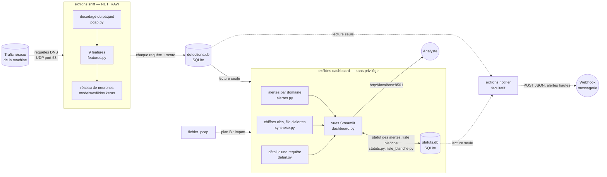

# Déployer exfildns

Guide pour mettre en service la détection d'exfiltration DNS sur une machine Linux, avec ou
sans Docker. Les choix techniques sont justifiés dans [decisions.md](decisions.md), le modèle
est expliqué dans [algorithme.md](algorithme.md).

## 1. Architecture



| Composant | Rôle | Privilèges |
|---|---|---|
| `exfildns sniff` | Capture les requêtes DNS d'une interface (ou les lit dans le journal d'un résolveur Unbound avec `--journal`), note chacune avec le modèle, les enregistre toutes dans SQLite, affiche les suspectes | `CAP_NET_RAW` (ou root) ; avec `--journal`, lecture du fichier seulement |
| `detections.db` | Base SQLite (mode WAL), table `requetes` : horodatage, poste, serveur DNS, nom demandé, type, score, taille de la requête (octets du message DNS) ; une base plus ancienne reçoit la colonne `taille` à l'ouverture par `sniff` ; avec `--retention N`, `sniff` supprime au démarrage puis toutes les heures les requêtes de plus de N jours | — |
| `exfildns dashboard` | Lit la base en lecture seule, regroupe les requêtes suspectes en alertes, affiche le tableau de bord ; analyse aussi un fichier PCAP déposé | aucun |
| `exfildns notifier` | Facultatif : relit les deux bases toutes les 30 s, recalcule les alertes comme le dashboard (liste blanche, statuts) et POSTe en JSON chaque alerte **haute** ouverte, une seule fois par alerte (de nouveau si elle disparaît de la fenêtre d'une heure puis revient, ou au redémarrage du service) | aucun |
| `statuts.db` | Base SQLite écrite par le dashboard seul, table `statuts_alertes` : domaine parent, statut (`nouvelle`, `en_cours`, `faux_positif`, `close`), commentaire, date du changement ; une alerte sans ligne est nouvelle. Table `liste_blanche` : domaines ajoutés depuis le dashboard, date d'ajout | — |

**Une alerte** est levée quand un même domaine reçoit au moins 5 requêtes jugées suspectes
(probabilité ≥ 0,5) : un tunnel DNS en envoie des centaines, un faux positif isolé une seule.
Les domaines de la liste blanche (CDN, cloud, plus ceux ajoutés depuis le panneau « Liste
blanche » du dashboard) n'alertent jamais.

La capture et le dashboard sont deux processus séparés : seul le premier a besoin de droits
réseau, et le dashboard (exposé à l'utilisateur) n'en a aucun.

## 2. Prérequis

- Une machine **Linux** (la capture utilise les sockets `AF_PACKET` du noyau).
- Le **modèle entraîné** `models/exfildns.keras`. Il se produit une fois, avec le dataset
  (README, section « Données ») : `uv run exfildns train`, ou en exécutant le notebook.
  Il n'est pas versionné ; on peut aussi le copier depuis une autre machine.
- **Avec Docker** : Docker Engine ≥ 24 et le plugin Compose.
- **Sans Docker** : [uv](https://docs.astral.sh/uv/) (Python 3.12 est installé par uv), et
  `libpcap` (paquet `libpcap0.8` sous Debian/Ubuntu, `libpcap` sous Fedora).

### Quelle interface surveiller ?

Celle par laquelle sort le trafic DNS, c'est-à-dire l'interface de la **route par défaut**.
C'est le choix automatique (`EXFILDNS_INTERFACE=auto`, défaut) : `sniff` affiche au démarrage
l'interface retenue (`docker compose logs sniff` : « Capture DNS sur wlp2s0… »). Pour vérifier
ou forcer une autre interface :

```bash
ip route get 1.1.1.1
# 1.1.1.1 via 192.168.0.1 dev eth0 src 192.168.0.5   ->  interface : eth0
```

Surveiller une autre interface (par exemple le Wi-Fi alors que le câble est branché) ne montre
rien : c'est le premier point à vérifier si aucune requête n'apparaît.

## 3. Déploiement avec Docker (recommandé)

```bash
git clone https://github.com/PabloHavane/exfildns.git && cd exfildns
cp /chemin/vers/exfildns.keras models/          # si le modèle vient d'ailleurs
cp .env.example .env                            # réglages facultatifs
docker compose up -d --build                    # premier build : ~0,7 Go à télécharger
```

Les rebuilds suivants sont rapides : les dépendances (~2,2 Go) forment une couche à part, refaite
seulement quand les dépendances de `uv.lock` changent (pas pour un simple changement de version
d'exfildns) ; une modification du code ne refait qu'une couche de quelques
centaines de Ko.

Ouvrir <http://localhost:8501>. Vérifier que la capture tourne :

```bash
docker compose ps                 # deux services « Up » (le dashboard « healthy »)
docker compose logs -f sniff      # « Capture DNS sur eth0… » puis les requêtes suspectes
```

Variables de `.env` :

| Variable | Rôle | Défaut |
|---|---|---|
| `EXFILDNS_INTERFACE` | Interface à surveiller ; `auto` : celle de la route par défaut | `auto` |
| `EXFILDNS_RETENTION` | Jours de conservation des requêtes dans `detections.db` (option `--retention` de `sniff`) | `30` |
| `TZ` | Fuseau des heures affichées (le conteneur est en UTC sinon) | `Europe/Paris` |
| `EXFILDNS_PORT` | Port local du dashboard | `8501` |
| `EXFILDNS_MOT_DE_PASSE` | Mot de passe demandé à l'ouverture du dashboard (vide : accès libre) | — |
| `EXFILDNS_WEBHOOK` | Adresse du webhook du service `notifier` (profil `notification`) | — |

**Notification des alertes hautes** (facultative) : renseigner `EXFILDNS_WEBHOOK` (webhook
entrant Slack, Mattermost, Rocket.Chat… : le champ `text` du JSON s'affiche tel quel), puis
`docker compose --profile notification up -d`. Le message contient le domaine parent, le nombre
de requêtes suspectes, le score max et les postes ; le domaine venant du réseau, il est réduit
aux lettres, chiffres, `.`, `_`, `:` et `-` (le reste devient `?`) pour qu'un nom forgé n'injecte ni
lien ni mention. Un envoi raté est retenté 30 s plus tard (`docker compose logs notifier`).

### Vérifier la détection

Sans outil d'attaque, une boucle `dig` produit des requêtes de la même forme qu'un tunnel
(numéro de morceau, données aléatoires, domaine fictif). Elles sont envoyées à `192.0.2.53`,
adresse réservée à la documentation et non routée : rien ne part vers un vrai serveur.

```bash
for i in $(seq 1 10); do
  dig +short +tries=1 +time=1 @192.0.2.53 \
    "$i.$(head -c 30 /dev/urandom | base64 | tr '+/' '-_' | tr -d '=').exfil-test.example"
done
```

Les 10 requêtes s'affichent dans `docker compose logs sniff` et le dashboard lève une alerte
vers `exfil-test.example`. Ce n'est qu'un test de l'installation : la démonstration utilise un
vrai outil d'exfiltration (section 5).

Arrêt : `docker compose stop` (la capture s'arrête proprement et affiche son bilan).
Les détections restent dans le volume `detections`, les statuts d'alertes dans le volume
`statuts` ; `docker compose down -v` efface les deux.

**Sécurité du déploiement** : les deux services tournent sous un utilisateur non root
(uid 10001), sans aucune capacité Linux sauf `NET_RAW` pour la capture, avec un système de
fichiers en lecture seule. Le dashboard monte les détections en lecture seule et n'écrit que
dans le volume `statuts`. Le dashboard n'est publié que sur `127.0.0.1` : il affiche les noms
demandés et les adresses des postes. Pour y accéder à distance, passer par un tunnel SSH
(`ssh -L 8501:localhost:8501 machine`) plutôt que de l'exposer ; s'il doit l'être, définir
`EXFILDNS_MOT_DE_PASSE` (long) et placer un proxy HTTPS devant.

## 4. Déploiement sans Docker

```bash
git clone https://github.com/PabloHavane/exfildns.git && cd exfildns
uv sync
# capture (terminal 1) : root ou CAP_NET_RAW
sudo .venv/bin/exfildns sniff -i eth0 --base detections.db
# dashboard (terminal 2) : utilisateur normal
uv run exfildns dashboard --base detections.db
```

Une base créée avec `sudo` appartient à root : pour passer ensuite à la variante ci-dessous,
la supprimer (`sudo rm detections.db*`) ou en choisir une autre.

Pour éviter `sudo`, donner la capacité de capture à une **copie** de l'interpréteur, comme
dans l'image Docker (le faire sur l'interpréteur commun l'accorderait à tous les scripts) :

```bash
cp "$(readlink -f .venv/bin/python)" .venv/bin/python-capture
sudo setcap cap_net_raw+ep .venv/bin/python-capture
.venv/bin/python-capture -m exfildns.cli sniff -i eth0 --base detections.db
```

### Source alternative : le journal d'un résolveur Unbound

Le capteur réseau ne voit que le trafic de sa machine (ou d'un port miroir). Si les postes
passent par un résolveur **Unbound**, son journal couvre tout le réseau. Dans `unbound.conf` :

```yaml
server:
    log-queries: yes          # une ligne par requête : client, nom, type
    use-syslog: no
    logfile: "/var/log/unbound/unbound.log"
    log-time-ascii: no        # horodatage Unix (défaut), seul format lu
```

```bash
.venv/bin/exfildns sniff --journal /var/log/unbound/unbound.log --base detections.db
```

`sniff` suit le fichier comme `tail -F` (nouvelles lignes seulement, rotation et troncature
gérées) et note chaque requête avec le même calcul de features que la capture. Il suffit de
pouvoir lire le fichier : aucune capacité réseau. Limites : pas de **taille** de message
(colonne vide), le **poste** est le client vu par le résolveur (un relais ou un NAT masque le
vrai poste), le **serveur DNS** est noté `résolveur`, Unbound peut remplacer dans le journal
les caractères inhabituels d'un nom (non ASCII, espaces…) par `?`, ce qui change les features
`special` et `entropy` de ces noms (base64, hex et base32 ne sont pas touchés), et le journal
grossit vite sur un réseau chargé (prévoir la rotation).

## 5. Scénario de démonstration

1. **Préparer** : modèle présent, `.env` renseigné, `docker compose up -d`, dashboard ouvert
   (période « 15 dernières minutes »). Navigation normale : capteur « actif » dans le bandeau,
   requêtes en bleu, file d'alertes vide.
2. **Exfiltrer** : depuis un poste dont le trafic DNS passe par l'interface surveillée, lancer
   l'outil d'exfiltration vers le domaine de l'attaquant : le mini-labo ci-dessous le fait sans
   réseau externe, sinon la boucle `dig` de la section 3 ou le plan B.
3. **Détecter** : en quelques secondes, les requêtes apparaissent en rouge dans le graphique
   avec un marqueur d'alerte ; la file d'alertes nomme le domaine de l'attaquant, sa sévérité
   et le poste à l'origine (aussi en tête du panneau « Top postes »).
4. **Enquêter** : onglet **Requêtes**, filtrer sur le domaine, cliquer une requête : le
   sous-domaine encodé est mis en évidence, ses features s'écartent de la moyenne des requêtes
   jugées bénignes par le modèle, la
   séquence montre la rafale, et l'essai de décodage révèle les octets exfiltrés (en
   hexadécimal ou ASCII échappé). Exporter la sélection en CSV ou JSON.
5. **Expliquer** : régler le seuil et le nombre de requêtes par alerte dans la barre latérale
   pour montrer leur effet ; renvoyer au notebook pour la méthode.

### Mini-labo : une vraie exfiltration DNS sur un réseau isolé

`compose.labo.yaml` monte un labo complet, sans aucune infrastructure externe :

| Service | Rôle |
|---|---|
| `attaquant` | serveur **iodine** (`iodined`) faisant autorité sur le domaine fictif `tunnel.labo`, reçoit le fichier par le tunnel |
| `victime` | client iodine (`-r` : DNS uniquement) qui envoie 200 Ko aléatoires par le tunnel, toutes les 30 s |
| `sniff` | `exfildns sniff` dans l'espace réseau de l'attaquant : il voit chaque requête DNS reçue |
| `dashboard` | dashboard du labo sur <http://localhost:8502> (8502 : peut tourner à côté du déploiement principal) |

```bash
docker compose -f compose.labo.yaml up --build -d   # prérequis : models/exfildns.keras, /dev/net/tun
docker compose -f compose.labo.yaml logs -f victime # « Connection setup complete » : le tunnel est ouvert
docker compose -f compose.labo.yaml down -v         # tout arrêter et vider les bases du labo
```

- **Isolement** : le réseau `labo` est `internal` (aucune route vers Internet) ; seul le
  dashboard, hors de ce réseau, publie un port, sur `127.0.0.1`.
- **Image de l'outil** : `labo/Dockerfile`, Debian épinglée par empreinte, paquets officiels
  `iodine` et `netcat-openbsd` en version fixée (pas d'image tierce).
- **Privilèges** : iodine crée une interface tunnel, d'où `NET_ADMIN` et `/dev/net/tun` pour
  ses deux conteneurs (toutes les autres capacités retirées) ; le capteur garde `NET_RAW` seul.
- Résultats mesurés (détectées / manquées) : [evaluation.md](evaluation.md#validation-en-conditions-réelles--mini-labo-iodine).

### Plan B : sans réseau

Si le réseau de la salle empêche la démonstration en direct, l'onglet **Analyser une
capture** du dashboard accepte un fichier `.pcap` (jusqu'à 100 Mo) et affiche les vues de la
supervision, puis le tableau de toutes ses requêtes (bénignes comprises) où l'étape
« Enquêter » se fait comme dans l'onglet Requêtes ; le bandeau reste celui de la capture en
direct :
par exemple `data/Attacks/heavy_text.pcap` du dataset (1 alerte, 26 907 requêtes suspectes sur
27 142) puis `data/Benign/benign_heavy_2.pcap` (aucune alerte). Les paquets du dataset étant
tronqués, l'alerte porte sur « (nom incomplet dans la capture) » et non sur un nom de domaine.
Le même résultat s'obtient en ligne de commande avec `uv run exfildns scan <fichier>`.

## 6. Dépannage

| Symptôme | Cause probable | Solution |
|---|---|---|
| `notifier` redémarre en boucle, « Adresse du webhook manquante » | `EXFILDNS_WEBHOOK` vide dans `.env` | la renseigner, puis `docker compose --profile notification up -d` |
| `sniff` redémarre en boucle | modèle absent ou illisible, interface inconnue | `docker compose logs sniff` donne la cause ; le modèle doit être lisible par tous (`chmod 644`) |
| Aucune requête dans le dashboard | mauvaise interface (forcée, ou route par défaut changée depuis le démarrage) | interface de `ip route get 1.1.1.1` ; avec `auto`, `docker compose restart sniff` |
| « Droits insuffisants pour capturer » | ni root ni `CAP_NET_RAW` | voir section 4 |
| « Capture impossible : … libpcap » | libpcap absent (hors Docker) | installer `libpcap0.8` / `libpcap` |
| Heures décalées d'une heure, ou axe de l'activité DNS sans heures | conteneur en UTC, fuseau différent de celui du navigateur | `TZ` dans `.env` |
| Capteur « silencieux » ou « inactif » alors que la capture tourne | aucune requête DNS depuis plus d'1 min (silencieux) ou 5 min (inactif) : l'état se déduit de la dernière requête reçue | normal sur un réseau calme ; `docker compose logs sniff` pour vérifier |
| « Aucune base de détections » | la capture n'a encore rien écrit | lancer `sniff`, attendre une requête DNS |

## 7. Limites connues

- **Modèle entraîné sur un seul outil** (DNSExfiltrator, données en base64) et sur du trafic
  bénin issu du top Alexa : un outil qui encode en minuscules (hexadécimal, base32) ou des noms
  légitimes longs et aléatoires (CDN, cloud) peuvent dégrader la détection. Dans le mini-labo,
  iodine est détecté (98 % des requêtes de données) car, sans résolveur intermédiaire, il
  encode en 8 bits ; via un vrai résolveur il peut passer en base32 minuscule (non testé). La liste blanche et le regroupement en
  alertes limitent les faux positifs.
- **Analyse requête par requête** : le volume et le rythme des requêtes ne servent qu'à
  regrouper les alertes, pas à détecter (pas de features *stateful*).
- **DNS chiffré** (DNS over HTTPS / TLS) : invisible pour la capture, qui ne voit que le DNS
  en clair sur le port 53.
- **Une seule machine** : la capture voit le trafic de la machine qui l'héberge (ou d'un port
  miroir). Surveiller un réseau entier demande de la placer sur la passerelle ou le résolveur.
- **Image Docker encore lourde** (~2,9 Go, dont 1,3 Go de TensorFlow CPU) pour un MLP de
  865 paramètres. Prédire sans TensorFlow (Keras 3 avec jax) gagnerait ~1,5 Go de plus (scores
  identiques à 3e-7 près), au prix de plus de changements : écarté avant la soutenance (#58).
