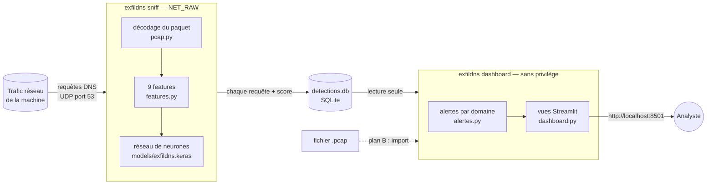

# Déployer exfildns

Guide pour mettre en service la détection d'exfiltration DNS sur une machine Linux, avec ou
sans Docker. Les choix techniques sont justifiés dans [decisions.md](decisions.md), le modèle
est expliqué dans [algorithme.md](algorithme.md).

## 1. Architecture



| Composant | Rôle | Privilèges |
|---|---|---|
| `exfildns sniff` | Capture les requêtes DNS d'une interface, note chacune avec le modèle, les enregistre toutes dans SQLite, affiche les suspectes | `CAP_NET_RAW` (ou root) |
| `detections.db` | Base SQLite (mode WAL) : horodatage, poste, serveur DNS, nom demandé, type, score | — |
| `exfildns dashboard` | Lit la base en lecture seule, regroupe les requêtes suspectes en alertes, affiche le tableau de bord ; analyse aussi un fichier PCAP déposé | aucun |

**Une alerte** est levée quand un même domaine reçoit au moins 5 requêtes jugées suspectes
(probabilité ≥ 0,5) : un tunnel DNS en envoie des centaines, un faux positif isolé une seule.
Les domaines de la liste blanche (CDN, cloud) n'alertent jamais.

La capture et le dashboard sont deux processus séparés : seul le premier a besoin de droits
réseau, et le dashboard (exposé à l'utilisateur) n'en a aucun.

## 2. Prérequis

- Une machine **Linux** (la capture utilise les sockets `AF_PACKET` du noyau).
- Le **modèle entraîné** `models/exfildns.keras`. Il se produit une fois, avec le dataset
  (README, section « Données ») : `uv run exfildns train`, ou en exécutant le notebook.
  Il n'est pas versionné ; on peut aussi le copier depuis une autre machine.
- **Avec Docker** : Docker Engine ≥ 24 et le plugin Compose.
- **Sans Docker** : [uv](https://docs.astral.sh/uv/) (Python 3.12 est installé par uv), et
  `libpcap` (paquet `libpcap0.8` sous Debian/Ubuntu, `libpcap` sous Fedora).

### Quelle interface surveiller ?

Celle par laquelle sort le trafic DNS, c'est-à-dire l'interface de la **route par défaut** :

```bash
ip route get 1.1.1.1
# 1.1.1.1 via 192.168.0.1 dev eth0 src 192.168.0.5   ->  interface : eth0
```

Surveiller une autre interface (par exemple le Wi-Fi alors que le câble est branché) ne montre
rien : c'est le premier point à vérifier si aucune requête n'apparaît.

## 3. Déploiement avec Docker (recommandé)

```bash
git clone https://github.com/PabloHavane/exfildns.git && cd exfildns
cp /chemin/vers/exfildns.keras models/          # si le modèle vient d'ailleurs
cp .env.example .env                            # puis renseigner EXFILDNS_INTERFACE
docker compose up -d --build                    # premier build : ~1 Go à télécharger
```

Ouvrir <http://localhost:8501>. Vérifier que la capture tourne :

```bash
docker compose ps                 # deux services « Up » (le dashboard « healthy »)
docker compose logs -f sniff      # « Capture DNS sur eth0… » puis les requêtes suspectes
```

Variables de `.env` :

| Variable | Rôle | Défaut |
|---|---|---|
| `EXFILDNS_INTERFACE` | Interface à surveiller (obligatoire) | — |
| `TZ` | Fuseau des heures affichées (le conteneur est en UTC sinon) | `Europe/Paris` |
| `EXFILDNS_PORT` | Port local du dashboard | `8501` |

### Vérifier la détection

Sans outil d'attaque, une boucle `dig` produit des requêtes de la même forme qu'un tunnel
(numéro de morceau, données aléatoires, domaine fictif). Elles sont envoyées à `192.0.2.53`,
adresse réservée à la documentation et non routée : rien ne part vers un vrai serveur.

```bash
for i in $(seq 1 10); do
  dig +short +tries=1 +time=1 @192.0.2.53 \
    "$i.$(head -c 30 /dev/urandom | base64 | tr '+/' '-_' | tr -d '=').exfil-test.example"
done
```

Les 10 requêtes s'affichent dans `docker compose logs sniff` et le dashboard lève une alerte
vers `exfil-test.example`. Ce n'est qu'un test de l'installation : la démonstration utilise un
vrai outil d'exfiltration (section 5).

Arrêt : `docker compose stop` (la capture s'arrête proprement et affiche son bilan).
Les détections restent dans le volume `detections` ; `docker compose down -v` les efface.

**Sécurité du déploiement** : les deux services tournent sous un utilisateur non root
(uid 10001), sans aucune capacité Linux sauf `NET_RAW` pour la capture, avec un système de
fichiers en lecture seule. Le dashboard n'est publié que sur `127.0.0.1` : il affiche les noms
demandés et les adresses des postes. Pour y accéder à distance, passer par un tunnel SSH
(`ssh -L 8501:localhost:8501 machine`) plutôt que de l'exposer.

## 4. Déploiement sans Docker

```bash
git clone https://github.com/PabloHavane/exfildns.git && cd exfildns
uv sync
# capture (terminal 1) : root ou CAP_NET_RAW
sudo .venv/bin/exfildns sniff -i eth0 --base detections.db
# dashboard (terminal 2) : utilisateur normal
uv run exfildns dashboard --base detections.db
```

Une base créée avec `sudo` appartient à root : pour passer ensuite à la variante ci-dessous,
la supprimer (`sudo rm detections.db*`) ou en choisir une autre.

Pour éviter `sudo`, donner la capacité de capture à une **copie** de l'interpréteur, comme
dans l'image Docker (le faire sur l'interpréteur commun l'accorderait à tous les scripts) :

```bash
cp "$(readlink -f .venv/bin/python)" .venv/bin/python-capture
sudo setcap cap_net_raw+ep .venv/bin/python-capture
.venv/bin/python-capture -m exfildns.cli sniff -i eth0 --base detections.db
```

## 5. Scénario de démonstration

1. **Préparer** : modèle présent, `.env` renseigné, `docker compose up -d`, dashboard ouvert
   (période « 15 dernières minutes »). Navigation normale : les requêtes s'affichent en bleu,
   « Aucune alerte ».
2. **Exfiltrer** : depuis un poste dont le trafic DNS passe par l'interface surveillée, lancer
   l'outil d'exfiltration vers le domaine de l'attaquant. *Outil et protocole à compléter avec
   l'issue #42 (homelab) ; d'ici là, la boucle `dig` de la section 3 ou le plan B ci-dessous.*
3. **Détecter** : en quelques secondes, les requêtes apparaissent en rouge dans le graphique,
   le bandeau d'alerte nomme le domaine de l'attaquant ; le tableau « Postes à l'origine des
   requêtes suspectes » donne l'adresse du poste, celui des requêtes montre les données
   encodées dans les noms.
4. **Expliquer** : régler le seuil et le nombre de requêtes par alerte dans la barre latérale
   pour montrer leur effet ; renvoyer au notebook pour la méthode.

### Plan B : sans réseau

Si le réseau de la salle empêche la démonstration en direct, l'onglet **Analyser une
capture** du dashboard accepte un fichier `.pcap` (jusqu'à 100 Mo) et affiche les mêmes vues :
par exemple `data/Attacks/heavy_text.pcap` du dataset (1 alerte, 26 907 requêtes suspectes sur
27 142) puis `data/Benign/benign_heavy_2.pcap` (aucune alerte). Les paquets du dataset étant
tronqués, l'alerte porte sur « (nom incomplet dans la capture) » et non sur un nom de domaine.
Le même résultat s'obtient en ligne de commande avec `uv run exfildns scan <fichier>`.

## 6. Dépannage

| Symptôme | Cause probable | Solution |
|---|---|---|
| `sniff` redémarre en boucle | modèle absent ou illisible, interface inconnue | `docker compose logs sniff` donne la cause ; le modèle doit être lisible par tous (`chmod 644`) |
| Aucune requête dans le dashboard | mauvaise interface | interface de `ip route get 1.1.1.1` |
| « Droits insuffisants pour capturer » | ni root ni `CAP_NET_RAW` | voir section 4 |
| « Capture impossible : … libpcap » | libpcap absent (hors Docker) | installer `libpcap0.8` / `libpcap` |
| Heures décalées d'une heure | conteneur en UTC | `TZ` dans `.env` |
| « Aucune base de détections » | la capture n'a encore rien écrit | lancer `sniff`, attendre une requête DNS |

## 7. Limites connues

- **Modèle entraîné sur un seul outil** (DNSExfiltrator, données en base64) et sur du trafic
  bénin issu du top Alexa : un outil qui encode en minuscules (hexadécimal, base32) ou des noms
  légitimes longs et aléatoires (CDN, cloud) peuvent dégrader la détection. La validation en
  conditions réelles est l'objet de l'issue #42 ; la liste blanche et le regroupement en
  alertes limitent les faux positifs.
- **Analyse requête par requête** : le volume et le rythme des requêtes ne servent qu'à
  regrouper les alertes, pas à détecter (pas de features *stateful*).
- **DNS chiffré** (DNS over HTTPS / TLS) : invisible pour la capture, qui ne voit que le DNS
  en clair sur le port 53.
- **Une seule machine** : la capture voit le trafic de la machine qui l'héberge (ou d'un port
  miroir). Surveiller un réseau entier demande de la placer sur la passerelle ou le résolveur.
- **Image Docker lourde** (~3,8 Go, dont 1,9 Go de TensorFlow) : allègement suivi dans #58.
